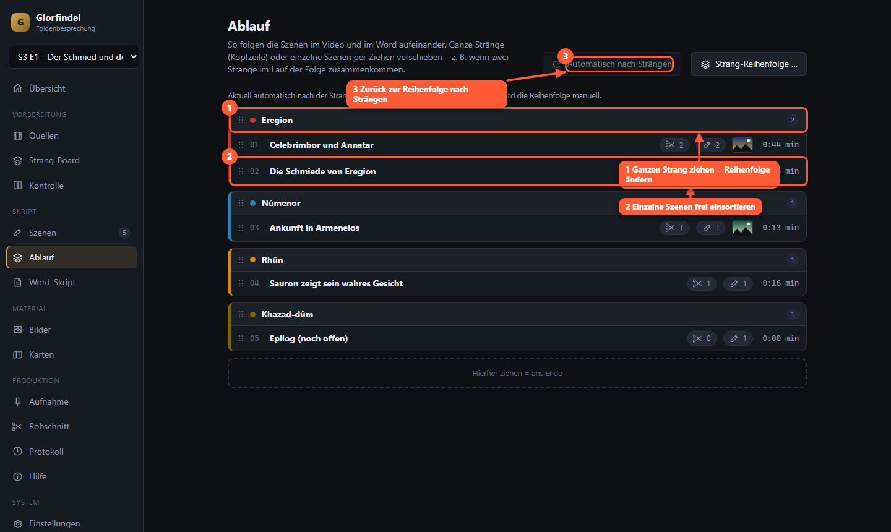

# Anleitung Projekt Glorfindel

Diese Anleitung führt dich von der Installation bis zum fertigen Rohschnitt. Sie steht auch in der Anwendung unter **Hilfe**.

## 1. Was das Tool macht

Glorfindel erzeugt aus der **Episode**, euren **Kommentaren**, **Bildern**, **Karten** und der **Sprachaufnahme** einen Rohschnitt für Premiere Pro. Feinschnitt, Musik, Karten-Animation und Export bleiben in Premiere.

**Der Ablauf, so wie ihr arbeitet:**

1. **Folge laden und verarbeiten** – Episode importieren; das Tool erzeugt die Vorschau, transkribiert den Dialog und schlägt Szenen vor.
2. **Nach Strängen aufteilen** – im Strang-Board ordnet ihr die Szenen den Handlungssträngen zu, damit zusammengehörende Handlung am Stück besprochen wird (erst alle Eregion-Stellen, dann alle Moria-Stellen – auch wenn die Episode anders verläuft).
3. **Durchgehen und besprechen** (z. B. Maurice) – in jeder Szene die **Stellen markieren**, die wirklich ins Video kommen (Segmente), je Segment einen **Kommentar** schreiben und **Bilder/Karten** direkt dort wählen.
4. **Reihenfolge anpassen** – Stränge und einzelne Szenen im **Ablauf** verschieben.
5. **Ausgeben** – Word-Arbeitsskript, **Sprecherskript** zum Vorlesen, Aufnahme zuordnen, Rohschnitt erzeugen.

**Wichtig:** Nur die **markierten Segmente** werden ins Video und ins Word übernommen. Kommentare gehören zu **Segmenten**, nicht zur ganzen Szene.

Alles läuft lokal auf deinem Rechner. Gemeinsame Daten liegen im OneDrive-Ordner der Folge, bearbeitet wird phasenweise nacheinander.

## 2. Installation

**Windows:** Rechtsklick auf `install.ps1`, „Mit PowerShell ausführen“. Das Skript installiert bei Bedarf `uv` und `ffmpeg`, richtet die Umgebung ein und fragt, ob lokales Whisper (Spracherkennung) installiert werden soll. Danach startest du das Tool mit `start.bat`.

**macOS/Linux:** `./install.sh`, danach `./start.sh`.

Beim Start öffnet sich dein Browser auf `http://localhost:8765`. Nutze **Chrome oder Edge** – nur dort laufen die Vorschauvideos zuverlässig.

**KI-Hilfen (optional):** Trage in der Datei `.env` deinen ScaDS-Schlüssel ein (`SCADS_API_KEY=…`). Ohne Schlüssel funktioniert alles andere weiter. Gib die Datei niemals weiter.

## 3. Ersteinrichtung

Beim ersten Start landest du in den **Einstellungen**. Oben siehst du den **Selbsttest** mit Häkchen:

- **ffmpeg gefunden** – ohne ffmpeg geht kein Video. Installations-Skript erneut ausführen.
- **OneDrive-Stammordner** – wähle den Ordner, in dem „Mythen-Archiv“ und „Videomaterial“ liegen. Vorschläge erscheinen als Knöpfe.
- **Dein Name** – er erscheint in Sperren und im Protokoll („wer hat was geändert“).
- **Transkription** – lokales Whisper (empfohlen, mit NVIDIA-Grafikkarte schnell) oder ScaDS.
- **ScaDS-Schlüssel** – nur für die KI-Hilfen.

Klicke danach auf **Speichern**. Die Einstellungen gelten nur für diesen Rechner.

Wichtig zum Datenschutz: Aufnahmen verlassen deinen Rechner nur, wenn du ausdrücklich „ScaDS.AI Whisper“ als Transkription wählst. Die Einstellung „Automatisch“ nutzt nie das Netz.

**Im Bild:** 1 Selbsttest (grün = in Ordnung, gelb = fehlt noch), 2 OneDrive-Stammordner wählen, 3 Namen eintragen, 4 speichern.

## 4. Eine Folge anlegen

Links oben im Folgen-Menü **+ Neue Folge anlegen …**. Das Tool schlägt die nächste Nummer vor. Titel ist optional. Mit Enter bestätigst du.

Nach dem Import der Referenz erscheint auf der Übersicht **Folge verarbeiten**: ein Klick erzeugt nacheinander das Vorschau-Video, transkribiert den **Dialog der Episode** (Whisper, Sprache automatisch) und erkennt Szenen. Jeder Schritt zeigt Fortschritt und Restzeit; du kannst währenddessen weiterarbeiten.

Die **Übersicht** zeigt dir pro Folge:

- vier Phasenkarten mit Häkchen, wenn die Phase erledigt ist,
- Kennzahlen: geschätzte Gesamtlänge, Serienanteil (Ziel 34 %), Szenen mit zu langem Segment,
- **Als Nächstes**: eine konkrete Liste, was noch fehlt (z. B. „3 Szenen ohne Serienmaterial“). Ein Klick springt direkt zur Stelle.

**Im Bild:** 1 die vier Phasen, 2 Kennzahlen (Serienanteil), 3 „Als Nächstes“ mit Sprungzielen, 4 Aufgabenleiste für Hintergrundaufträge.

## 5. Quellen importieren

Ansicht **Quellen**.

1. **Referenz importieren**: wähle die Episode (z. B. die Bildschirmaufnahme). Die **Referenz** bestimmt die Zeitachse aller Szenen.
2. Das Tool liest Länge und Bildrate und erzeugt automatisch einen **Proxy** (kleine, schnell abspielbare Version). Fortschritt siehst du links unten bei **Aufgaben**.
3. **Weitere Quelle**: später z. B. die HQ-Version (deutsch) oder den Screener. Sie wird über **Ankerpunkte** auf die Referenz abgebildet.
4. **Zuschnitt** erkennt schwarze Balken (Letterbox) automatisch.
5. **Anker** (Zeitcodes) kannst du hier tippen, bequemer geht es in der Ansicht **Kontrolle** (Kapitel 12).

Zeiten werden als `mm:ss.zz` (Sekunden mit Hundertstel) eingegeben, z. B. `01:23.50`. `mm:ss:bb` meint Bilder.

**Im Bild:** 1 Referenz importieren, 2 Rolle jeder Quelle, 3 Proxy für die schnelle Vorschau, 4 Ankerpunkte für die HQ-Fassung.

## 6. Strang-Board

Das Board schlägt aus der Referenz automatisch **Szenen** vor (Schnitt- und Tonpausen) und sortiert sie nach **Strängen**.

1. **Szenen erkennen** (oder „Folge verarbeiten“ auf der Übersicht).
2. Lege oben deine **Stränge** fest (z. B. Eregion, Númenor). Farbe, Name und Reihenfolge sind änderbar; auch die Strang-Spuren lassen sich am Griff `⋮⋮` ziehen. Die Reihenfolge bestimmt die Reihenfolge im Schnitt und im Word.
3. **Ansehen:** Doppelklick auf einen Vorschlag (oder ▶) öffnet einen **eigenen Player**: die Szene läuft in Schleife, mit „Vorherige/Nächste“ und Direktzuordnung zum Strang.
4. **Mehrere gleichzeitig:** Klick wählt aus, **Strg+Klick** fügt hinzu, **Umschalt+Klick** wählt von … bis. Dann oben mit einem Klick dem Strang zuordnen, alle gemeinsam ziehen oder zu **einer** Szene verbinden. „Alle wählen“ in der Strang-Kopfzeile nimmt den ganzen Strang.
5. Pro Vorschlag: Zeiten ändern, mit der Schere **teilen**, **verbinden**, verwerfen.
6. **Zugeordnete als Szenen anlegen** erzeugt die Szenen – **ohne Segmente**. Die Segmente markierst du anschließend im Szenen-Editor.

**Im Bild:** 1 Stränge und ihre Reihenfolge, 2 Auswahl-Leiste (mehrere Vorschläge einem Strang zuordnen), 3 ausgewählter Vorschlag mit Player, 4 als Szenen anlegen.

## 7. Szenen bearbeiten: Segmente markieren und kommentieren

Hier verbringt ihr die meiste Zeit. Links die Szenenliste, in der Mitte Player und Dialog, rechts die **Segmente** der Szene mit ihren Kommentaren.

**Szene oder Segment?** Eine **Szene** ist die Einheit, die die Szenenerkennung findet – eine reine **Messeinheit** mit Nummer und Zeitbereich. Szenen werden **nicht gelöscht** und kommen **nicht automatisch ins Video**. Ins Video (und ins Word-Skript) kommen **nur Segmente**. Ein Segment kann
- eine **ganze Szene** sein („Ganze Szene als Segment“),
- **mehrere Szenen überspannen** („Über mehrere Szenen …“ oder einfach mit I/O über die Grenze hinaus markieren),
- oder nur einen **Teil einer Szene** ausmachen.

Segmente kannst du jederzeit löschen. Jedes Segment zeigt, welche Szenen es überdeckt („ganze Szene 4“, „Teil von Szene 7“, „über Szenen 2–5“). In der Liste sind Szenen ohne Segment abgedunkelt und mit „nicht im Video“ markiert; reicht ein Segment aus einer anderen Szene hinein, steht dort „+1“. Überschneiden sich zwei Segmente, warnt dich der Editor, denn dieselbe Stelle käme doppelt ins Video.

Projekte aus der ersten Version bekommen beim ersten Öffnen einmalig die Messeinheiten nachgetragen: Der Zeitbereich jeder Szene wird gespeichert und die damals automatisch angelegten 9,5-Sekunden-Segmente werden entfernt – **nur wenn du sie nicht bearbeitet hast**. Segmente mit Kommentar oder Notiz und alle selbst gesetzten bleiben. Von jeder geänderten Szene liegt vorher eine Sicherung im Ordner `glorfindel/sicherung`.

**Im Bild:** 1 Suche und Filter, 2 Szene auf einen Blick (Segmente, Kommentare je Sprecher, Vorschaubilder), 3 Zeitleiste mit Szenenbereich, Segmenten und Kommentarmarken, 4 Dialog der Episode, 5 Segmentkarte, 6 Segment abspielen.

**Szenenliste:** Ein Klick auf eine Szene **springt im Player zur Stelle**. Ampelpunkt (grün/gelb/rot = Längenampel, grau = noch kein Segment, Szene abgedunkelt = nicht im Video), Strang, Status und darunter Zähler für Segmente und Kommentare (mit Punkten für Philipp/Danny) sowie Vorschaubilder der eingeblendeten Bilder/Karten. Suche über Titel, Kommentare und Notizen; Filter u. a. „Nicht im Video“, „Im Video“, „Ohne Kommentar“. Filter und Auswahl **bleiben erhalten**, wenn du die Ansicht wechselst.

**Segmente markieren – nur das kommt ins Video:**
- **Im Dialog:** Die Episode ist transkribiert. Klick auf ein Wort springt dorthin, **Wörter ziehen** markiert eine Stelle → **Als Segment markieren**. Die Zeiten kommen aus den Wörtern.
- **Im Player:** `I` setzt den Anfang, `O` das Ende – danach entsteht das Segment. Zeiten lassen sich auch tippen.
- Bei jedem Segment steht automatisch der **gesprochene Dialog** („…“) und darunter eine **Notiz** für zusätzlichen Kontext (sie erscheint als Regieanweisung im Sprecherskript).
- **Abspielen** spielt genau dieses Segment.

**Kommentare je Segment:** Unter jedem Segment mit **Kommentar hinzufügen**. Pro Kommentar: Sprecher (Philipp/Danny), Modus **Text** (wörtlich) oder **Stichpunkte** (frei ausformuliert), und mit dem Auswahlfeld lässt er sich einem anderen Segment zuordnen. Segmente ohne Kommentar laufen im Rohschnitt als Montage weiter; nach einem Segment **mit** Kommentar folgt das Standbild mit dem Sprechertext.

**Bilder und Karten direkt im Kommentar:** Wörter im Text markieren, dann **Bild / Karte einblenden**. Der Picker zeigt **Vorschaubilder**: Bilder dieser Folge, die Bibliothek (Suche, Stichwörter), Web-Adressen – und unter **Karten** vorhandene oder **neue Karten** aus der Bibliothek, die du sofort einzeichnest. Danach ist im Kommentartext **farbig markiert, von welchem bis zu welchem Wort** das Bild/die Karte erscheint; darunter steht es als Chip mit Vorschaubild. Klick auf den Chip ändert den Bereich (erstes und letztes Wort anklicken) und das Layout.

**Speichern:** automatisch. Neben dem Titel steht „Gespeichert 14:32:10“. `Strg+S` speichert sofort.

**Zusammenarbeit:** Öffnet jemand anderes dieselbe Szene, erscheint ein Hinweis. Speichert er zwischendurch, bekommst du einen Dialog: „Aktuelle laden“ oder „Meine speichern“.

**Löschen:** Eine gelöschte Szene lässt sich 12 Sekunden lang mit **Rückgängig** zurückholen; danach liegt sie im Ordner `glorfindel/papierkorb`.

**Status:** neu → Skript fertig → aufgenommen → abgeglichen. Ändert sich Text oder Segment einer schon aufgenommenen Szene, wird sie **veraltet** und muss neu abgeglichen werden.

**KI-Hilfen** (wenn Schlüssel vorhanden): Namen prüfen, Bild-Ideen, Titelvorschlag.

## 8. Ablauf: Reihenfolge von Strängen und Szenen

Hier legst du fest, in welcher Reihenfolge Szenen/Segmente im Video und im Word erscheinen.

**Im Bild:** 1 ganzer Strang – an der Kopfzeile ziehen verschiebt den ganzen Block, 2 einzelne Szenen lassen sich frei einsortieren (auch zwischen andere Stränge, wenn Handlungen zusammenlaufen), 3 zurück zur automatischen Sortierung nach Strängen.

Solange nichts verschoben wurde, gilt die Reihenfolge der Stränge aus dem Board. Sobald du eine Szene verschiebst, ist die Reihenfolge **manuell**; „Automatisch nach Strängen“ setzt sie zurück. Zeile anklicken öffnet die Szene im Editor.

## 9. Word-Skripte

Zwei verschiedene Dokumente:

- **Arbeitsskript** (zum Zurückspielen): gegliedert nach Szene → Segment → Kommentar. Die kleinen Marken (`⟦sz:…⟧`, `⟦sg:…⟧`, Bild-Marken mit Namen) bitte nicht löschen – darüber werden Änderungen zugeordnet. Optionen: Marken zeigen, nach Strängen sortieren. Das bearbeitete Dokument spielst du zurück; vorab siehst du, welche Szenen sich ändern.
- **Sprecherskript** (nur zum Vorlesen): Regieanweisungen je Segment (Notiz und der gesprochene Dialog der Stelle), der Kommentartext ungestört und Bild-/Kartenhinweise als **Randnotiz** („Einblendung → Bild: Alan Lee – Celebrimbor – ab „…““). Keine technischen Marken. Der Sprecher darf frei ändern – das hat keine Auswirkung auf das Projekt. Download für Philipp, Danny oder beide.

**Rahmenteile** (Intro, Werbung, Outro) mit **bekannter Dauer** reservieren im Rohschnitt eine Lücke exakter Länge. **Altformat importieren:** Skripte mit `[Szenen]` und `P:`/`D:`-Zeilen.

**Im Bild:** 1 Arbeitsskript exportieren, 2 bearbeitetes Word zurückspielen, 3 Sprecherskript, 4 Rahmenteile mit fester Dauer.

## 10. Bilder und Karten

Ausgewählt wird direkt im Kommentar (Kapitel 7). Die Ansichten **Bilder** und **Karten** dienen zum Pflegen:

**Bilder:** Bibliothek durchsuchen (Name, Titel, Stichwörter, Ordner). Credit und Konturfarbe werden vorbelegt und sind änderbar. Mit **Aus Web holen** übernimmst du ein Bild von einer Adresse. Die **Künstler-Datenbank** ordnet Dateinamen einem Credit-Text zu; sie wächst mit und gilt für alle Folgen. Animierte Bilder (`.mov`) zeigen eine Vorschau und lassen sich im Bearbeiten-Dialog abspielen. **Bildindex aktualisieren** liest neue Dateien ein.

**Im Bild:** 1 ein Bild der Folge (anklicken zum Bearbeiten), 2 Künstler-Datenbank, 3 Bibliothek durchsuchen.

**Karten:** Karte wählen und **Einzeichnen**: Marker, Text, Pfeil/Pfad, Region und Kamerarahmen (mehrere Rahmen = Kamerafahrt). Jedes Element hat eine **eigene Farbe** und einen Einsatzzeitpunkt. **Vorschau** spielt die Animation direkt im Browser ab (Kamerafahrt, Pfeile zeichnen sich, Elemente blenden ein). **Platzhalter rendern** erzeugt das Kartenblatt und den Platzhalter-Clip; **Clip** spielt ihn ab.

**Im Bild (Editor):** 1 Werkzeug wählen, 2 Karte anklicken und zeichnen, 3 Elemente mit Farbe, Einsatzzeitpunkt, Kamerarahmen und Hinweisen.

## 11. Aufnahme

1. **Philipp** / **Danny**: Aufnahme-Datei wählen (eine pro Sprecher, auch „alle“ möglich).
2. **Abgleich starten**: Das Tool transkribiert und ordnet jeden Kommentar (je Segment) der Aufnahme zu. Bei mehreren Takes zählt der letzte.
3. Die Wellenform zeigt die zugeordneten Bereiche; Klick springt zur Stelle. `Leertaste`/`K` Pause, `J`/`L` springen zurück/vor.
4. Pro Block siehst du die **Sicherheit** (Prozent). Mit „Nur unsichere Stellen“ und „Nächste unsichere“ prüfst du nur, was nötig ist. Bei mehreren Takes wählst du den passenden im Menü. Zeiten lassen sich nachtippen und mit dem Haken speichern.
5. Spontan Ergänzendes wird blau angezeigt.

**Im Bild:** 1 Aufnahme je Sprecher hinzufügen, 2 Abgleich starten, 3 Wellenform (Farbflächen = zugeordnete Blöcke), 4 nur unsichere Stellen prüfen, 5 Sicherheit der Zuordnung.

## 12. Kontrolle und HQ-Austausch

Du arbeitest mit dem Screener; vor dem Render wird auf die HQ-Fassung getauscht, ohne dass Feinschnitt verloren geht. Die Kontrolle richtet beide Fassungen zeitlich aus (**Anker**) und läuft komplett im Browser: Beim Verschieben wird nichts auf dem Server gerechnet.

**So setzt du einen Anker:**
1. **Zeit in der Referenz** wählen (Schieberegler, Zeitfeld oder ◀▶-Tasten). Die Quelle springt automatisch auf die Stelle, die die bisherigen Anker vorhersagen.
2. Die **Quelle nachjustieren**, bis dasselbe Bild zu sehen ist: Bild für Bild (`←`/`→`, mit Umschalt 10), ±1 s, ±10 s. Die **Übereinstimmung** (live berechnet) zeigt, wie gut beide Bilder passen.
3. Ansicht umschalten: **Nebeneinander**, **Überblendung** oder **Differenz** (schwarz = gleich).
4. **Hier verknüpfen** (oder `Enter`).

Setze einen Anker am Anfang und einen am Ende, bei Werbepausen o. ä. weitere dazwischen. Grüne Marken am Regler zeigen gesetzte Anker, „Hin“ in der Liste springt zu ihnen. **Beide abspielen** (`Leertaste`) lässt die Quelle der Referenz folgen.

**Im Bild:** 1 Zeit in der Referenz, 2 beide Videos, 3 Darstellung, 4 Live-Übereinstimmung, 5 HQ-Conform.

**Im Bild:** 1 Quelle nachjustieren, 2 Anker setzen, 3 gesetzte Anker.

- **Szenenprüfung:** prüft Anfang und Ende jedes Segments automatisch (läuft als Hintergrundaufgabe).
- **HQ-Conform:** erzeugt eine passend ausgerichtete HQ-Datei (ProRes oder DNxHR).

## 13. Rohschnitt erzeugen

> Empfohlen ist der direkte Weg über Premiere (Abschnitt 13b). Das Paket und die XML hier sind die Notlösung ohne Premiere-Verbindung.

Ansicht **Rohschnitt** → **Rohschnitt erzeugen**. Optionen: nach Strängen sortieren, Standbilder erzeugen, Quelle für Standbilder.

- **Aufbau:** je markiertem Segment der Ausschnitt der Episode; hat das Segment einen Kommentar, folgt das **Standbild** mit Sprechertext, Bildern und Karten – Segmente ohne Kommentar laufen als Montage weiter. Nur markierte Segmente kommen vor.
- Das Ergebnis ist ein **Schnittpaket** (`schnitt_vN.json`) plus eine **Premiere-XML** als Fallback. Jede Erzeugung legt eine neue Version an, alte bleiben erhalten.
- Unter **Vorschau** siehst du alle Spuren als Balken. Mit dem Zoom schaust du genauer hin.
- **Warnungen** nennen genau, was fehlt (z. B. „noch keine Aufnahme zugeordnet“). **Zur Szene** springt direkt hin.
- Das Premiere-Panel (Ordner `premiere-panel`) liest das Schnittpaket. Es ist ein Skelett und noch nicht getestet. Bis dahin importierst du die **Premiere-XML** (enthält Clips, Standbilder, Audio und Marker; Credits und Effekte müssen von Hand ergänzt werden).

**Im Bild:** 1 Rohschnitt erzeugen, 2 Vorschau aller Spuren, 3 Warnungen mit Sprung zur Szene.

## 13b. Premiere: direkte Verbindung (Bridge)

Seit Version 0.2 kann die App **direkt in Premiere arbeiten**, statt eine XML-Datei zu liefern. Der XML-Export bleibt als Notlösung (keine Effekte, keine Credits, keine Animationen).

**Einrichten (einmalig):** Ansicht **Premiere** → „Panel einrichten“, die Rückfrage bestätigen, Premiere neu starten, **Fenster → Erweiterungen → „Glorfindel Bridge“** öffnen. In der App steht dann „Mit Premiere verbunden“. Das Panel muss geöffnet bleiben.

**Rohschnitt bauen:** „In Premiere bauen“. Die App
1. macht aus der Referenz eine **konforme Fassung** (konstante Bildrate, ohne Balken; liegt die HQ-Datei nur zeitlich versetzt, ist die Referenz gleich auf deren Zeitachse verschoben) – dieselbe Datei liegt in Premiere und liefert die Standbilder, deshalb passen Bild und Standbild genau,
2. erzeugt die Standbilder, die Credit-Grafiken und eine Sequenz-Vorgabe mit allen Spuren,
3. baut in deinem geöffneten Projekt eine **neue Sequenz „Rohschnitt … vN“**: Szenen aus einer verschachtelten Episoden-Sequenz (V1, Ton A4), Standbilder, Sprecher (A2/A3), Pause/Play (V7), Artworks in je einer **verschachtelten Sequenz** (Bild + Maske + Spurmaske-Key; Schatten, Zoom, Fancy In/Out liegen auf der Sequenz, V3/V4), Karten mit Ein-/Ausfahrt, Schwarzstreifen (V8), Credits (V9/V10/V13), Gauß In/Out als Einstellungsebene (V2) und Marker.

Nach dem Bau zeigt die App, was **nicht** gebaut werden konnte, und Hinweise. Bestehende Sequenzen werden nie verändert.

**Proxy ↔ HQ:** **„Auf HQ umschalten“** tauscht nur die Datei der Episoden-Sequenz und ersetzt die Standbilder durch Bilder aus der HQ-Datei (eigener Ordner, nichts wird überschrieben, Rückweg jederzeit). Alle Clips, Effekte, Animationen und alles, was du von Hand geändert hast, bleibt. Ist die HQ-Datei nur zeitlich verschoben (Normalfall: ein Ankerpunkt), wird sie **unverändert** eingesetzt – ein HQ-Conform ist dann nicht nötig. Nur bei Tempounterschieden braucht es weiterhin den „HQ-Conform“ in der Kontrolle.

**Änderungen aus Premiere übernehmen:** Hast du in Premiere einen Serienclip verlängert, gekürzt oder in der Mitte geschnitten, klickst du unter *Premiere → Änderungen aus Premiere* auf **„Aus Premiere einlesen“**. Die App zeigt, was sich geändert hat, und übernimmt auf Wunsch die neuen Ein- und Ausstiegspunkte in die Segmente (ein Schnitt in der Mitte wird zu zwei Segmenten). Das Etikett oben rechts in diesem Bereich zeigt danach **„Tausch nötig: n Standbild(er)“**. Ein Klick auf **„Standbilder in Premiere tauschen“** erzeugt die Standbilder neu und ersetzt sie in Premiere am gleichen Ort; dein Schnitt und deine Handarbeit bleiben unverändert. Gelöschte Clips meldet die App nur, sie löscht nichts. Gilt für Rohschnitte, die mit dieser Version gebaut wurden (Clips heißen „sz_xx Segment n“).

**Diagnose:** Der **Selbsttest** prüft in einem Test-Fach, ob Effekte, Farben und Keyframes in deiner Premiere-Version so ankommen wie geplant (und räumt auf). Mit **„Aktive Sequenz auslesen“** siehst du Spuren, Clips und Effekte zum Vergleich mit dem Ursprungsschnitt.

**Grenzen:** Premiere erlaubt Plugins keine zusätzlichen Spuren, Textgrafiken, neue Einstellungsebenen oder Audio-Blenden „Konstante Leistung“. Darum: eigene Sequenz-Vorgabe, Credits als Bild mit Transparenz (nicht als Text editierbar), Audio-Blenden von Hand. Für **Gauß In/Out** legst du einmal im Projekt **Datei → Neu → Einstellungsebene** an (Name „Einstellungsebene“); die App setzt sie dann auf V2. Fehlt sie, liegt der Weichzeichner ersatzweise direkt am Standbild.

**Effekte und Artwork-Ausschnitt wählen:** unter **Einstellungen → Premiere-Rohschnitt** (Zoom schnell/langsam, Fancy, Karten-Animation, Artwork-Größe, Maske). Die Effekte werden direkt aus deinen `.prfpset`-Vorgaben gelesen. Bei einzelnen Artworks wählt die App die Maske nach dem Bildformat (Querformat → „Maske“, Quadrat/Hochformat → „Maske Quadrat“) und zeigt möglichst viel vom Bild. Optional kann ein ScaDS-Bildmodell das Hauptmotiv erkennen (Einstellungen → KI-Hilfen → „Automatischer Bildausschnitt“, sendet verkleinerte Artwork-Bilder an ScaDS.AI).

## 13c. Szenen zusammenfassen, Formatierung, Karten

- **Shots zu Szenen zusammenfassen:** Im Szenen-Editor Shots links per Häkchen wählen (Umschalt-Klick für einen Bereich), **„Zusammenfassen“**, Titel eingeben. Die Szene erscheint als Gruppe in der Liste (zuklappbar, umbenennbar, auflösbar) und setzt im Premiere-Schnitt einen Marker. Die Shots selbst bleiben unverändert.
- **Kommentare formatieren:** Über dem Kommentar steht eine Leiste: fett, kursiv, unterstrichen, durchgestrichen, Überschrift, Listen, Einrücken, Textfarbe und Hervorhebung (Strg+B/I/U gehen auch). „Vorschau“ zeigt das Ergebnis. Die Formatierung dient dir beim Sprechen; für Wortzählung, Abgleich und Bild-Einblendungen zählt nur der reine Text.
- **Karteneditor:** Jedes Element hat **Anfang (ab) und Ende (bis)**; leer = bleibt bis zum Schluss. Mit dem **Mausrad zoomen**, mit Leertaste oder mittlerer/rechter Maustaste halten und ziehen verschieben.
- **Bild aus dem Video markieren:** Im Szenen-Editor speichert das Bildsymbol in der Player-Leiste das aktuelle Bild (volle Auflösung) und öffnet es im Karteneditor. In der Ansicht **Karten** gibt es dasselbe über **„Karte aus Videobild“**.

## 14. Protokoll und Konflikte

Ansicht **Protokoll**: wer hat wann was geändert. Haben zwei gleichzeitig dieselbe Szene bearbeitet, legt OneDrive eine Konfliktkopie an. Sie erscheint oben mit **Vergleichen & lösen**: beide Versionen nebeneinander, du behältst eine.

**Im Bild:** 1 wer hat wann was geändert.

## 15. Aufgabenleiste und Fortschrittsanzeigen

Alles, was länger dauert, läuft im Hintergrund und zeigt genau, was gerade passiert:

- **Gesamtbalken** mit Prozent, **Laufzeit**, geschätzter **Restzeit** und der Uhrzeit, zu der die Aufgabe voraussichtlich fertig ist.
- **Schritt x von y** mit Namen, z. B. „Bildschnitte erkennen“, „Standbilder erzeugen“ oder „Aufnahme 2/2: transkribieren“.
- **Teilfortschritt** im aktuellen Schritt: „3 von 12 Standbildern“, bei Videos die verarbeitete Videozeit und das Tempo („1:19 von 1:20 · 3,4× Echtzeit“), beim Transkribieren die erkannte Audiozeit.
- **Schrittliste** mit Häkchen, laufendem Schritt, wartenden Schritten und der Dauer jedes erledigten Schritts.
- Bei Fehlern steht die Ursache direkt dabei (zum Kopieren), bei Erfolg die Gesamtdauer.

Links unten in der Seitenleiste zeigt **Aufgaben** immer den aktuellen Schritt, Prozent und Restzeit. Ein Klick öffnet alle laufenden und letzten Aufträge; ein Klick auf eine abgeschlossene Aufgabe klappt ihre Schritte auf. **Abbrechen** stoppt auch ffmpeg-Aufgaben sofort.

Auch kürzere Wartezeiten sind sichtbar: Seiten zeigen beim Laden, was sie gerade abrufen, und KI-Anfragen zählen die Wartezeit mit.

**Im Bild:** 1 Gesamtbalken mit Laufzeit, Restzeit und Fertig-Uhrzeit, 2 aktueller Schritt mit Teilfortschritt, 3 alle Schritte mit Dauer, 4 Abbrechen.

## 16. Tastenkürzel

**Szenen-Editor**

- `I` / `O` – Anfang / Ende markieren (danach entsteht das Segment)
- `Leertaste` oder `K` – Abspielen/Pause
- `J` / `L` – 2 s zurück / vor
- `←` / `→` – ein Bild zurück / vor (mit Umschalt: zehn)
- `Alt+↑` / `Alt+↓` – vorherige / nächste Szene
- `Alt+Umschalt+↑/↓` – Szene verschieben
- `Strg+Enter` – neuer Kommentar im aktuellen Segment
- `Strg+S` – sofort speichern

**Board:** Klick = wählen, `Strg+Klick` = hinzufügen, `Umschalt+Klick` = von … bis, Doppelklick = ansehen.
**Aufnahme:** `Leertaste`/`K`, `J`, `L`. Dialoge: `Enter` bestätigt, `Esc` schließt.

## 17. Tipps für schnelles Arbeiten

- Erst „Folge verarbeiten“, dann Board: spart das Suchen der Zeitpunkte.
- Dialog-Stellen direkt im Dialogfeld markieren statt Zeiten zu tippen.
- Stichpunkt-Modus nutzen, wenn ihr frei sprecht – danach „Als Skript“.
- Wörter im Kommentar markieren, dann Bild wählen – der Bereich ist sofort farbig sichtbar.
- In der Aufnahme nur „unsichere Stellen“ prüfen.
- Vor dem Rohschnitt die **Als Nächstes**-Liste leeren.

## 18. Probleme und Lösungen

- **Video spielt nicht ab:** Chrome oder Edge verwenden; Proxy erzeugen (Quellen → Proxy).
- **„ffmpeg fehlt“:** `install.ps1`/`install.sh` erneut ausführen, danach neues Terminal öffnen.
- **Abgleich meldet „Whisper fehlt“:** lokales Whisper installieren oder in den Einstellungen ScaDS-Whisper wählen (sendet die Aufnahme an ScaDS.AI).
- **„KI nicht erreichbar“:** Netzwerk und Schlüssel in `.env` prüfen; Einstellungen → „Verbindung testen“.
- **Datei „nur online“ (OneDrive):** Ordner auf „Immer auf diesem Gerät behalten“ stellen.
- **Szene wurde inzwischen geändert:** im Dialog bewusst entscheiden; im Zweifel „Aktuelle laden“.
- **Segment liegt hinter dem Ende der Episode:** im Szenen-Editor korrigieren; der Rohschnitt nennt die Szene.
- **Zeitangaben stimmen nicht:** Format ist `mm:ss.zz` (Hundertstel), nicht Bilder.

## 19. Begriffe

- **Referenz** – die Episode, die die Zeitachse festlegt.
- **Anker** – Paar „Zeit in Referenz = Zeit in Quelle“; mehrere Anker gleichen Versatz und Tempo aus.
- **Strang** – Handlungsstrang/Ort; bestimmt Reihenfolge und Farbe.
- **Szene** – Messeinheit aus der Szenenerkennung (Nummer, Zeitbereich); wird nicht gelöscht, kommt nicht automatisch ins Video.
- **Segment** – ein Stück Serienmaterial, das ins Video kommt: eine ganze Szene, mehrere Szenen oder ein Teil einer Szene (Längenampel ab 9,5 s).
- **Standbild** – letztes (oder erstes) Bild der Szene, darunter läuft der Kommentar.
- **Proxy** – kleine Vorschauversion für die Oberfläche.
- **Schnittpaket** – die Datei, aus der der Rohschnitt in Premiere gebaut wird.
