# Anleitung Projekt Glorfindel

Diese Anleitung führt dich von der Installation bis zum fertigen Rohschnitt. Sie steht auch in der Anwendung unter **Hilfe**.

## 1. Was das Tool macht

Glorfindel erzeugt aus der **Episode**, eurem gemeinsam geschriebenen **Skript**, **Bildern**, **Kartenplatzhaltern** und der **Sprachaufnahme** einen Rohschnitt für Premiere Pro. Feinschnitt, Musik, Karten-Animation und Export bleiben in Premiere.

Der Ablauf in vier Phasen:

- **Vorbereiten** – Episode importieren, Szenen festlegen (Philipp / Maurice).
- **Skript** – Kommentare schreiben, Bilder und Karten zuordnen (Philipp und Danny).
- **Einsprechen** – Aufnahme importieren, automatisch den Szenen zuordnen.
- **Rohschnitt** – Schnittpaket erzeugen und in Premiere öffnen (Maurice).

Alles läuft lokal auf deinem Rechner. Gemeinsame Daten liegen im OneDrive-Ordner der Folge, bearbeitet wird phasenweise nacheinander.

## 2. Installation

**Windows:** Rechtsklick auf `install.ps1`, „Mit PowerShell ausführen“. Das Skript installiert bei Bedarf `uv` und `ffmpeg`, richtet die Umgebung ein und fragt, ob lokales Whisper (Spracherkennung) installiert werden soll. Danach startest du das Tool mit `start.bat`.

**macOS/Linux:** `./install.sh`, danach `./start.sh`.

Beim Start öffnet sich dein Browser auf `http://localhost:8765`. Nutze **Chrome oder Edge** – nur dort laufen die Vorschauvideos zuverlässig.

**KI-Hilfen (optional):** Trage in der Datei `.env` deinen ScaDS-Schlüssel ein (`SCADS_API_KEY=…`). Ohne Schlüssel funktioniert alles andere weiter. Gib die Datei niemals weiter.

## 3. Ersteinrichtung

Beim ersten Start landest du in den **Einstellungen**. Oben siehst du den **Selbsttest** mit Häkchen:

- **ffmpeg gefunden** – ohne ffmpeg geht kein Video. Installations-Skript erneut ausführen.
- **OneDrive-Stammordner** – wähle den Ordner, in dem „Mythen-Archiv“ und „Videomaterial“ liegen. Vorschläge erscheinen als Knöpfe.
- **Dein Name** – er erscheint in Sperren und im Protokoll („wer hat was geändert“).
- **Transkription** – lokales Whisper (empfohlen, mit NVIDIA-Grafikkarte schnell) oder ScaDS.
- **ScaDS-Schlüssel** – nur für die KI-Hilfen.

Klicke danach auf **Speichern**. Die Einstellungen gelten nur für diesen Rechner.

Wichtig zum Datenschutz: Aufnahmen verlassen deinen Rechner nur, wenn du ausdrücklich „ScaDS.AI Whisper“ als Transkription wählst. Die Einstellung „Automatisch“ nutzt nie das Netz.

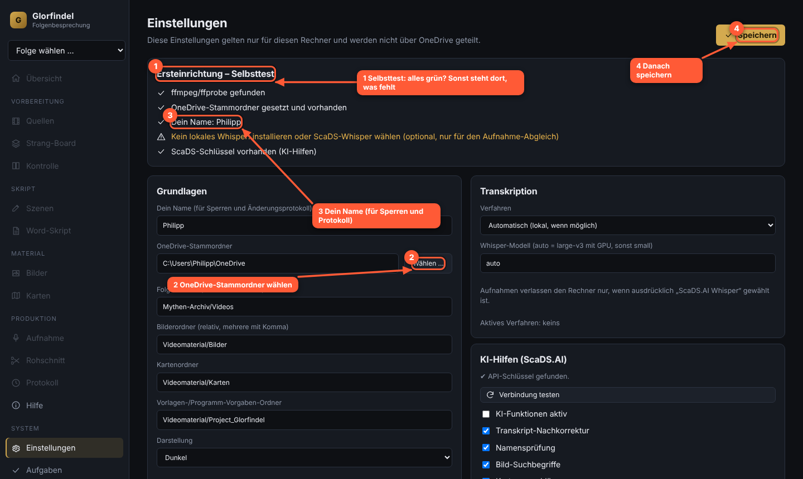

**Im Bild:** 1 Selbsttest (grün = in Ordnung, gelb = fehlt noch), 2 OneDrive-Stammordner wählen, 3 Namen eintragen, 4 speichern.

## 4. Eine Folge anlegen

Links oben im Folgen-Menü **+ Neue Folge anlegen …**. Das Tool schlägt die nächste Nummer vor. Titel ist optional. Mit Enter bestätigst du.

Die **Übersicht** zeigt dir pro Folge:

- vier Phasenkarten mit Häkchen, wenn die Phase erledigt ist,
- Kennzahlen: geschätzte Gesamtlänge, Serienanteil (Ziel 34 %), Szenen mit zu langem Segment,
- **Als Nächstes**: eine konkrete Liste, was noch fehlt (z. B. „3 Szenen ohne Serienmaterial“). Ein Klick springt direkt zur Stelle.

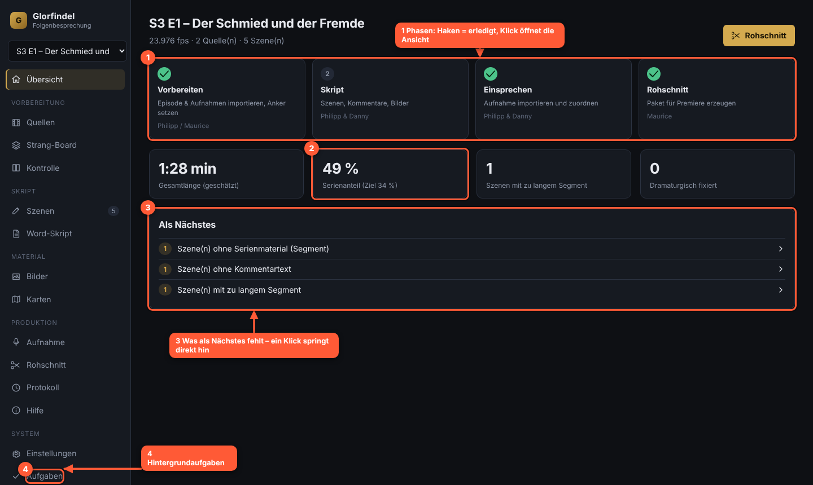

**Im Bild:** 1 die vier Phasen, 2 Kennzahlen (Serienanteil), 3 „Als Nächstes“ mit Sprungzielen, 4 Aufgabenleiste für Hintergrundaufträge.

## 5. Quellen importieren

Ansicht **Quellen**.

1. **Referenz importieren**: wähle die Episode (z. B. die Bildschirmaufnahme). Die **Referenz** bestimmt die Zeitachse aller Szenen.
2. Das Tool liest Länge und Bildrate und erzeugt automatisch einen **Proxy** (kleine, schnell abspielbare Version). Fortschritt siehst du links unten bei **Aufgaben**.
3. **Weitere Quelle**: später z. B. die HQ-Version (deutsch) oder den Screener. Sie wird über **Ankerpunkte** auf die Referenz abgebildet.
4. **Zuschnitt** erkennt schwarze Balken (Letterbox) automatisch.
5. **Anker** (Zeitcodes) kannst du hier tippen, bequemer geht es in der Ansicht **Kontrolle** (Abschnitt 11).

Zeiten werden als `mm:ss.zz` (Sekunden mit Hundertstel) eingegeben, z. B. `01:23.50`. `mm:ss:bb` meint Bilder.

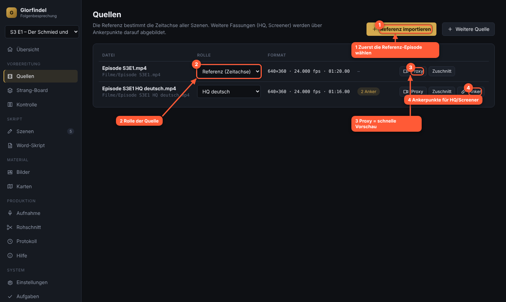

**Im Bild:** 1 Referenz importieren, 2 Rolle jeder Quelle, 3 Proxy für die schnelle Vorschau, 4 Ankerpunkte für die HQ-Fassung.

## 6. Strang-Board (optional, spart Zeit)

Das Board schlägt aus der Referenz automatisch **Szenen** vor (Schnitt- und Tonpausen).

1. **Szenen erkennen** – das dauert einige Minuten, der Fortschritt läuft im Hintergrund.
2. Lege oben deine **Stränge** fest (z. B. Eregion, Númenor). Farbe, Name und Reihenfolge sind änderbar; die Reihenfolge bestimmt die Reihenfolge im Schnitt und im Word.
3. **Ziehe** Vorschläge mit der Maus in den passenden Strang.
4. Pro Vorschlag: Zeiten anpassen, mit der Schere **teilen**, mit der Kette **mit dem nächsten verbinden**, mit × verwerfen.
5. **Zugeordnete als Szenen anlegen** erzeugt die Szenen im Szenen-Editor.

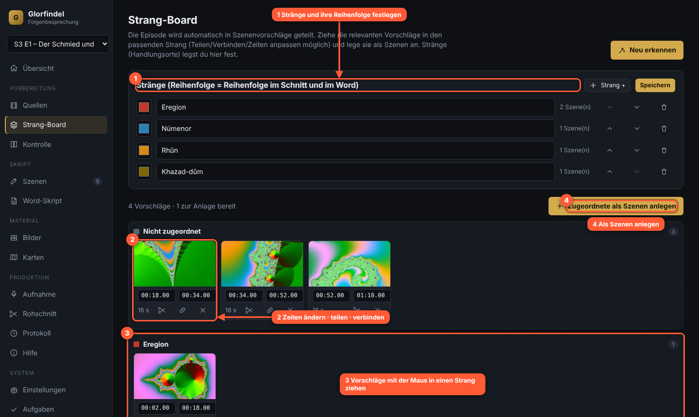

**Im Bild:** 1 Stränge und ihre Reihenfolge, 2 Vorschlag mit Zeiten, Teilen, Verbinden und Verwerfen, 3 Vorschläge in einen Strang ziehen, 4 als Szenen anlegen.

## 7. Szenen schreiben (Szenen-Editor)

Hier verbringt ihr die meiste Zeit. Links die Szenenliste, rechts die Szene.

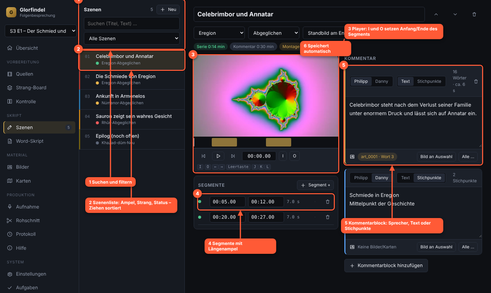

**Im Bild:** 1 Suche und Filter, 2 Szenenliste mit Längenampel, 3 Player mit `I`/`O`, 4 Segmente, 5 Kommentarblöcke, 6 Speicherstatus.

**Liste:** Suche nach Titel oder Text, Filter (Strang, Status, „ohne Segment“, „zu langes Segment“). Farbpunkt = **Längenampel** (grün passt, gelb knapp, rot zu lang; Grenze ist 9,5 s pro Segment). Per Maus lässt sich die Reihenfolge ändern, oder mit den Pfeilknöpfen neben dem Titel. Die Zahl links ist die Nummer in Word und Rohschnitt.

**Segmente:** Eine Szene besteht aus einem oder mehreren Stücken der Serie (Montage). Im Player die Stelle suchen, `I` setzt den Anfang, `O` das Ende. Zeiten lassen sich auch tippen.

**Kommentarblöcke:** Pro Block wählst du den Sprecher (Philipp/Danny) und den Modus:

- **Text** – wird wörtlich gesprochen.
- **Stichpunkte** – ein Punkt pro Zeile; wird frei ausformuliert gesprochen und später per Schlüsselwörtern zugeordnet. Danach lässt sich der gesprochene Text mit **Als Skript** übernehmen.

**Bilder und Karten zuordnen:** Markiere im Text ein paar Wörter und klicke **Bild an Auswahl**. Wähle das Bild; es wird ab dieser Stelle eingeblendet (Layout: einzeln oder Doppelbild links/rechts). Über **Alle …** siehst du alle Zuordnungen eines Blocks.

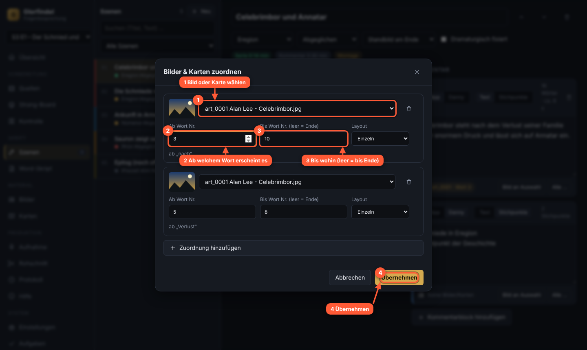

**Im Bild:** 1 Bild oder Karte wählen, 2 ab welchem Wort es erscheint, 3 bis wohin, 4 übernehmen.

**Speichern:** automatisch. Neben dem Titel steht „Gespeichert 14:32:10“. `Strg+S` speichert sofort.

**Zusammenarbeit:** Öffnet jemand anderes dieselbe Szene, erscheint ein Hinweis. Speichert er zwischendurch, bekommst du einen Dialog: „Aktuelle laden“ oder „Meine speichern“. So geht nichts unbemerkt verloren.

**Löschen:** Eine gelöschte Szene lässt sich 12 Sekunden lang mit **Rückgängig** zurückholen; danach liegt sie im Ordner `glorfindel/papierkorb`.

**Status:** neu → Skript fertig → aufgenommen → abgeglichen. Ändert sich der Text einer schon aufgenommenen Szene, wird sie **veraltet** und muss neu abgeglichen werden.

**KI-Hilfen** (wenn Schlüssel vorhanden, Funkel-Symbole): Namen prüfen, Bild-Ideen aus dem Text, Kartenvorschlag, Titelvorschlag. Vorschläge übernimmst du immer selbst.

## 8. Word-Skript

Für Sprecher, die lieber in Word lesen und schreiben.

- **Exportieren**: gesamt, nur Philipp oder nur Danny. Optionen: Bild-/Kartenmarken zeigen, nach Strängen sortieren.
- **Zurückübernehmen**: das bearbeitete Dokument wählen. Du siehst vorab, welche Szenen sich ändern.
- Lösche die Marken im Dokument nicht (`⟦sz:…⟧`, `⟦+bild:…⟧`). Eigene Rahmenteile wie Werbung oder Outro legst du als „Überschrift 1“ an.
- **Rahmenteile**: Intro, Werbung, Outro mit **bekannter Dauer** eintragen. Der Rohschnitt reserviert dafür eine Lücke exakter Länge.
- **Altformat importieren**: bestehende Skripte mit `[Szenen]` und `P:`/`D:`-Zeilen.

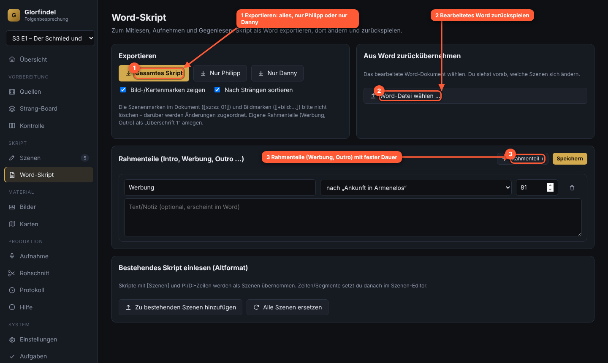

**Im Bild:** 1 Export als Word, 2 bearbeitetes Word zurückspielen, 3 Rahmenteile mit fester Dauer.

## 9. Bilder und Karten

**Bilder:** Bibliothek durchsuchen (Name, Titel, Stichwörter, Ordner), Klick fügt ein Bild zur Folge hinzu. Credit und Konturfarbe werden vorbelegt und sind änderbar. Mit **Aus Web holen** übernimmst du ein Bild von einer Adresse. Die **Künstler-Datenbank** ordnet Dateinamen einem Credit-Text zu; sie wächst mit und gilt für alle Folgen. **Bildindex aktualisieren** liest neue Dateien ein.

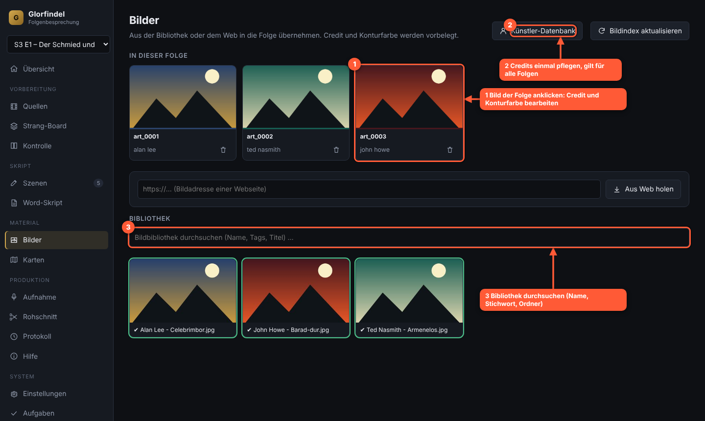

**Im Bild:** 1 ein Bild der Folge (anklicken zum Bearbeiten), 2 Künstler-Datenbank, 3 Bibliothek durchsuchen.

**Karten:** Karte aus der Bibliothek wählen, dann **Einzeichnen**: Marker, Text, Pfeil/Pfad, Region und Kamerarahmen (mehrere Rahmen = Kamerafahrt). Pro Element lässt sich der Einsatzzeitpunkt angeben. **Platzhalter rendern** erzeugt das Kartenblatt (Skizze + Hinweise) und einen Platzhalterclip für Danny.

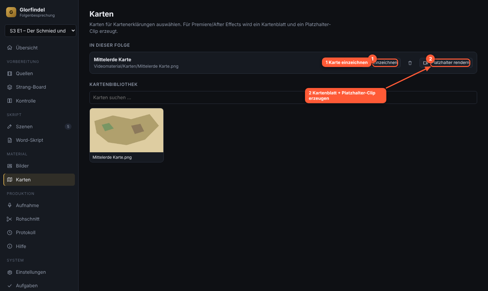

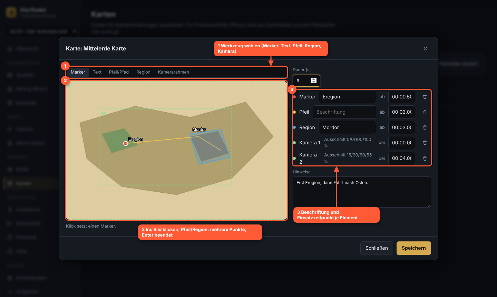

**Im Bild (Editor):** 1 Werkzeug wählen, 2 Karte anklicken und zeichnen, 3 Elemente mit Einsatzzeitpunkt, Kamerarahmen und Hinweisen.

## 10. Aufnahme

1. **Philipp** / **Danny**: Aufnahme-Datei wählen (eine pro Sprecher, auch „alle“ möglich).
2. **Abgleich starten**: Das Tool transkribiert und ordnet jeden Kommentarblock der Aufnahme zu. Bei mehreren Takes zählt der letzte.
3. Die Wellenform zeigt die zugeordneten Bereiche; Klick springt zur Stelle. `Leertaste`/`K` Pause, `J`/`L` springen zurück/vor.
4. Pro Block siehst du die **Sicherheit** (Prozent). Mit „Nur unsichere Stellen“ und „Nächste unsichere“ prüfst du nur, was nötig ist. Bei mehreren Takes wählst du den passenden im Menü. Zeiten lassen sich nachtippen und mit dem Haken speichern.
5. Spontan Ergänzendes wird blau angezeigt.

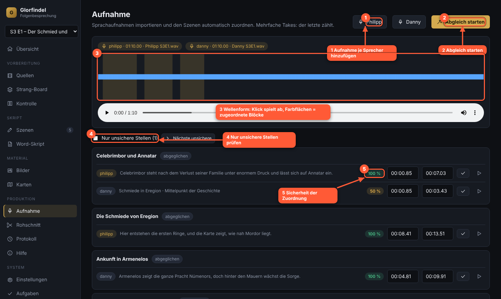

**Im Bild:** 1 Aufnahme je Sprecher hinzufügen, 2 Abgleich starten, 3 Wellenform (Farbflächen = zugeordnete Blöcke), 4 nur unsichere Stellen prüfen, 5 Sicherheit der Zuordnung.

## 11. Kontrolle und HQ-Austausch

Du arbeitest mit dem Screener; vor dem Render wird auf die HQ-Fassung getauscht, ohne dass Feinschnitt verloren geht.

- **Anker setzen**: Beide Player auf dasselbe Bild stellen (Bildschritt, ±1 s, ±10 s), **Hier verknüpfen**. Setze einen Anker am Anfang und einen am Ende, bei Werbepausen o. ä. weitere dazwischen. **Quelle auf Referenzzeit springen** hilft beim Finden.
- **Vergleich**: Schieberegler wählt einen Zeitpunkt; links Referenz, rechts Quelle, oder die Differenz. Die Übereinstimmung zeigt, ob die Zeitabbildung stimmt.
- **Szenenprüfung**: prüft Anfang und Ende jedes Segments automatisch.
- **HQ-Conform**: erzeugt eine passend ausgerichtete HQ-Datei (ProRes oder DNxHR).

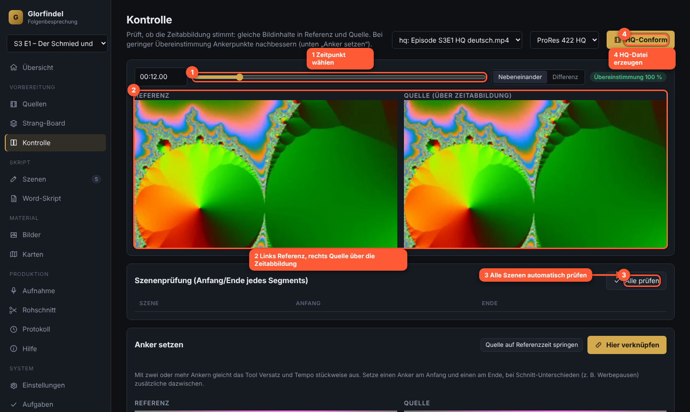

**Im Bild:** 1 Zeitpunkt wählen, 2 links Referenz und rechts Quelle, 3 alle Szenen prüfen, 4 HQ-Conform.

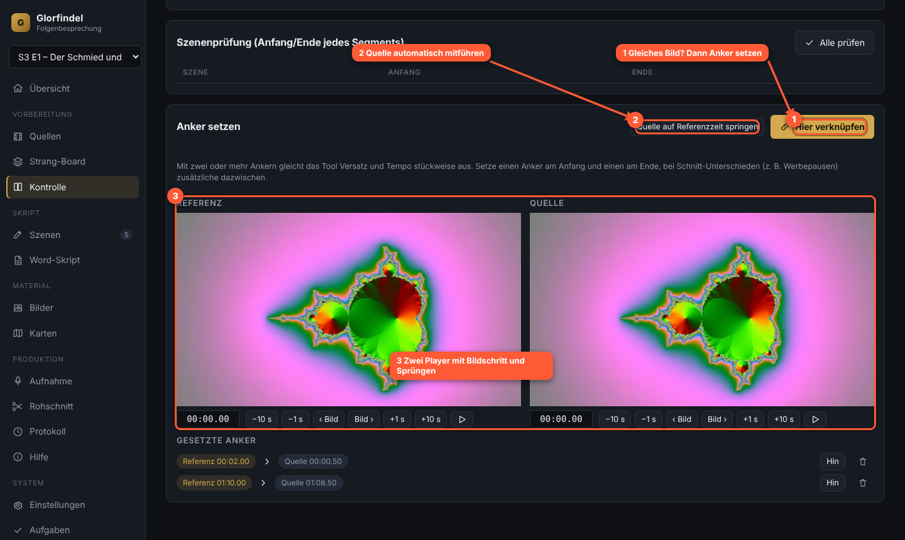

**Im Bild:** 1 „Hier verknüpfen“ setzt den Anker, 2 Quelle folgt der Referenz, 3 zwei Player mit Bildschritt.

## 12. Rohschnitt erzeugen

Ansicht **Rohschnitt** → **Rohschnitt erzeugen**. Optionen: nach Strängen sortieren, Standbilder erzeugen, Quelle für Standbilder.

- Das Ergebnis ist ein **Schnittpaket** (`schnitt_vN.json`) plus eine **Premiere-XML** als Fallback. Jede Erzeugung legt eine neue Version an, alte bleiben erhalten.
- Unter **Vorschau** siehst du alle Spuren als Balken. Mit dem Zoom schaust du genauer hin.
- **Warnungen** nennen genau, was fehlt (z. B. „noch keine Aufnahme zugeordnet“). **Zur Szene** springt direkt hin.
- Das Premiere-Panel (Ordner `premiere-panel`) liest das Schnittpaket. Es ist ein Skelett und noch nicht getestet. Bis dahin importierst du die **Premiere-XML** (enthält Clips, Standbilder, Audio und Marker; Credits und Effekte müssen von Hand ergänzt werden).

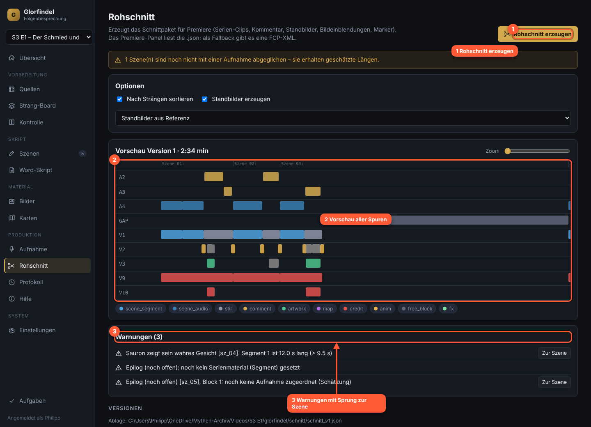

**Im Bild:** 1 Rohschnitt erzeugen, 2 Vorschau aller Spuren, 3 Warnungen mit Sprung zur Szene.

## 13. Protokoll und Konflikte

Ansicht **Protokoll**: wer hat wann was geändert. Haben zwei gleichzeitig dieselbe Szene bearbeitet, legt OneDrive eine Konfliktkopie an. Sie erscheint oben mit **Vergleichen & lösen**: beide Versionen nebeneinander, du behältst eine.

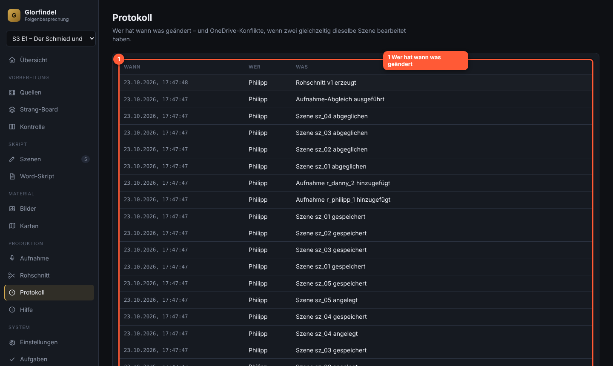

**Im Bild:** 1 wer hat wann was geändert.

## 14. Aufgabenleiste

Links unten **Aufgaben**: alle laufenden und letzten Hintergrundaufträge (Proxy, Abgleich, Rohschnitt …) mit Fortschritt, **Abbrechen** und Fehlerdetails zum Kopieren. Sie bleibt auch nach Seitenwechsel erhalten.

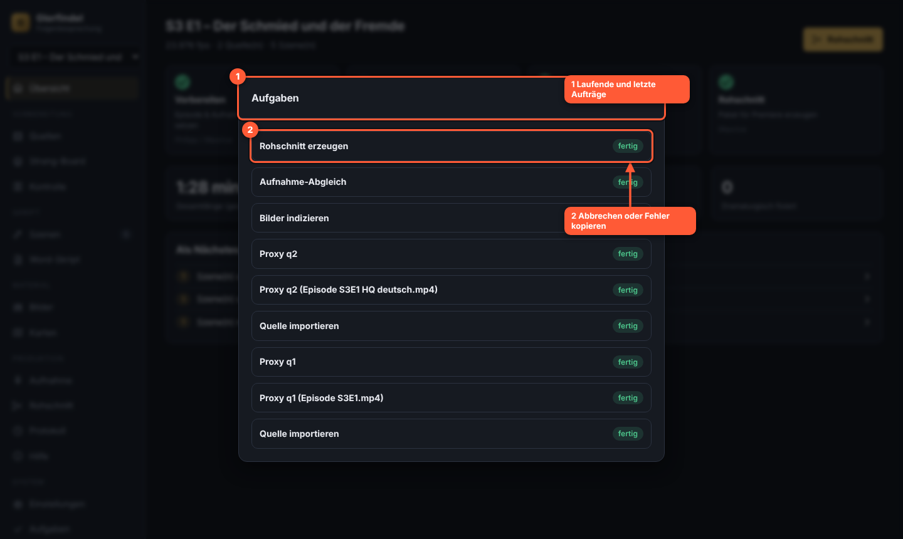

**Im Bild:** 1 laufende und letzte Aufträge, 2 Abbrechen oder Fehler kopieren.

## 15. Tastenkürzel

**Szenen-Editor**

- `I` / `O` – Segment-Anfang / -Ende setzen
- `Leertaste` oder `K` – Abspielen/Pause
- `J` / `L` – 2 s zurück / vor
- `←` / `→` – ein Bild zurück / vor (mit Umschalt: zehn)
- `Alt+↑` / `Alt+↓` – vorherige / nächste Szene
- `Alt+Umschalt+↑/↓` – Szene verschieben
- `Strg+Enter` – neuer Kommentarblock
- `Alt+1` / `Alt+2` – Sprecher Philipp / Danny
- `Strg+S` – sofort speichern

**Aufnahme**: `Leertaste`/`K`, `J`, `L`. Dialoge: `Enter` bestätigt, `Esc` schließt.

## 16. Tipps für schnelles Arbeiten

- Erst Board, dann Szenen füllen: spart das Suchen der Zeitpunkte.
- Stichpunkt-Modus nutzen, wenn ihr frei sprecht – danach „Als Skript“.
- Bilder per Textauswahl zuordnen statt Wörter zu zählen.
- In der Aufnahme nur „unsichere Stellen“ prüfen.
- Vor dem Rohschnitt die **Als Nächstes**-Liste leeren.

## 17. Probleme und Lösungen

- **Video spielt nicht ab:** Chrome oder Edge verwenden; Proxy erzeugen (Quellen → Proxy).
- **„ffmpeg fehlt“:** `install.ps1`/`install.sh` erneut ausführen, danach neues Terminal öffnen.
- **Abgleich meldet „Whisper fehlt“:** lokales Whisper installieren oder in den Einstellungen ScaDS-Whisper wählen (sendet die Aufnahme an ScaDS.AI).
- **„KI nicht erreichbar“:** Netzwerk und Schlüssel in `.env` prüfen; Einstellungen → „Verbindung testen“.
- **Datei „nur online“ (OneDrive):** Ordner auf „Immer auf diesem Gerät behalten“ stellen.
- **Szene wurde inzwischen geändert:** im Dialog bewusst entscheiden; im Zweifel „Aktuelle laden“.
- **Segment liegt hinter dem Ende der Episode:** im Szenen-Editor korrigieren; der Rohschnitt nennt die Szene.
- **Zeitangaben stimmen nicht:** Format ist `mm:ss.zz` (Hundertstel), nicht Bilder.

## 18. Begriffe

- **Referenz** – die Episode, die die Zeitachse festlegt.
- **Anker** – Paar „Zeit in Referenz = Zeit in Quelle“; mehrere Anker gleichen Versatz und Tempo aus.
- **Strang** – Handlungsstrang/Ort; bestimmt Reihenfolge und Farbe.
- **Segment** – ein Stück Serienmaterial einer Szene (höchstens 9,5 s).
- **Standbild** – letztes (oder erstes) Bild der Szene, darunter läuft der Kommentar.
- **Proxy** – kleine Vorschauversion für die Oberfläche.
- **Schnittpaket** – die Datei, aus der der Rohschnitt in Premiere gebaut wird.
